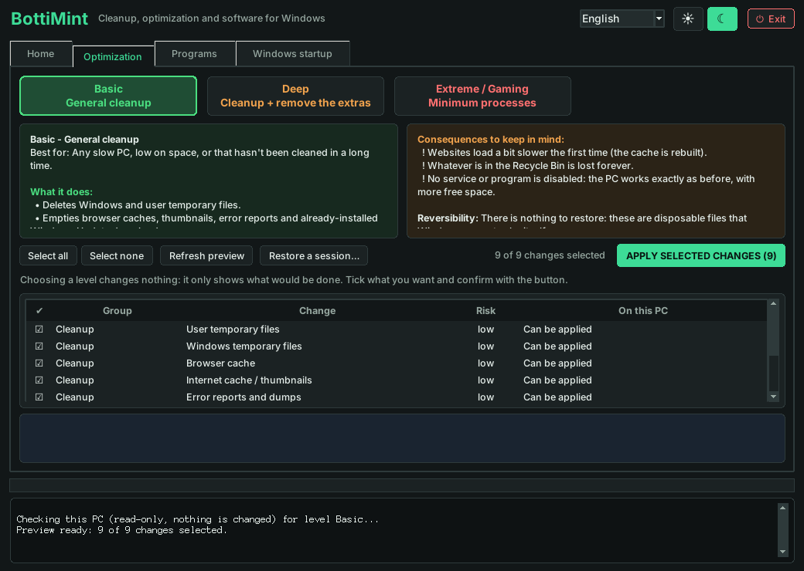

# BottiMint

🇺🇸 [English](README.md) · 🇦🇷 Español

> La documentación principal está en inglés. Este README en español es un resumen de entrada; el detalle está en `docs/` (en inglés).

Herramienta para **Windows 10 / 11** para todo el mundo: limpia, optimiza por niveles (todo **reversible**) e instala el software que necesitás, desde una sola interfaz.



> Las capturas son de ejemplo; el aspecto exacto depende del tema de Windows.

## Qué hace

| Módulo | Qué incluye |
|---|---|
| **Optimización por niveles** | **Básico** (limpieza general) · **Profundo** (+ quitar apps y publicidad de fábrica, limpiar y desanclar el menú Inicio, apagar Copilot, desinstalar OneDrive (opcional), telemetría programada, programas de inicio) · **Extremo / Gaming** (+ servicios, procesos en segundo plano, efectos visuales, energía). Cada cambio explica **qué hace y qué consecuencia tiene**. |
| **Restauración** | Antes de tocar nada crea un **punto de restauración de Windows** y verifica que exista (si falla, **no cambia nada**). Además guarda el estado original de cada ajuste y los deshace con un clic. |
| **Programas** | Catálogo corto y curado (navegadores, esenciales, utilidades, desarrollo, **gaming**: Steam, Epic, Ubisoft, EA, GOG, Battle.net…, runtimes) con **perfiles** (oficina, gamer, herramientas). Instala con **winget**, en silencio. |
| **Inicio de Windows** | Lista y habilita/deshabilita programas que arrancan con la PC (reversible). |
| **Informes** | Genera un informe con lo hecho, las consecuencias y cómo volver atrás, para guardar o compartir. |

Detalle completo: [docs/NIVELES.md](docs/NIVELES.md) · [docs/PROGRAMAS.md](docs/PROGRAMAS.md) (en inglés).

En VMs de 4 GB los tres niveles bajaron el Administrador de tareas de **164 a 107 procesos** y de **3,4 a 1,9 GB** de memoria en uso en Windows 11, y de **144 a 89 procesos** y de **1,8 a 1,3 GB** en Windows 10 ([informe con capturas y aclaraciones](docs/VM_TEST_REPORT.md)).

## Cómo instalarlo

**Opción A - el `.exe` (sin instalar Python)**
1. Entrá a **[Releases](../../releases/latest)** y bajá `BottiMint.exe` y `BottiMint.exe.sha256`.
2. Verificá la integridad (PowerShell):
   ```powershell
   (Get-FileHash .\BottiMint.exe -Algorithm SHA256).Hash.ToLower()   # debe coincidir con el contenido del .sha256
   ```
3. Ejecutalo (pide permisos de administrador).

**Opción B - un script que descarga, verifica y ejecuta**
```powershell
# PowerShell. Leé el script antes de ejecutarlo: scripts/descargar_y_ejecutar.ps1
irm https://raw.githubusercontent.com/shadoowww/bottimint-optimizer/main/scripts/descargar_y_ejecutar.ps1 -OutFile $env:TEMP\od.ps1
powershell -ExecutionPolicy Bypass -File $env:TEMP\od.ps1 -Repo shadoowww/bottimint-optimizer
```
Descarga la última versión, **comprueba el SHA256** y recién después la ejecuta.

**Opción C - desde el código (requiere Python 3.10+)**
```bash
git clone https://github.com/shadoowww/bottimint-optimizer.git
cd bottimint-optimizer
python -m bottimint          # interfaz gráfica (ejecutar como administrador)
```
O doble clic en `scripts/BottiMint.bat` (pide administrador solo).

> **Aviso sobre SmartScreen / antivirus:** el `.exe` no está firmado digitalmente y está empaquetado con PyInstaller, por lo que Windows SmartScreen o algunos antivirus pueden mostrar una advertencia o un falso positivo. Por eso se publica el SHA256 y el código es abierto: podés auditarlo o compilarlo vos (`scripts/Compilar_exe.bat`).

## Uso

### Interfaz gráfica
1. **Inicio:** revisá los datos del equipo (RAM, disco, SSD/HDD, batería, winget, permisos).
2. **Optimización:** elegí el nivel → leé qué hace y las **consecuencias** (leelas con calma) → revisá y ajustá la lista de cambios (las opciones riesgosas vienen desmarcadas según el equipo) → **Aplicar cambios marcados**. Hay que tildar que entendiste las consecuencias.
3. **Restaurar una sesión…** deshace una optimización anterior.
4. **Programas:** marcá un perfil (oficina / gamer / herramientas) o elegí a mano → **Instalar seleccionados**.

### Consola
```text
python -m bottimint optimizar niveles                  # explica los 3 niveles
python -m bottimint optimizar plan --nivel extremo     # vista previa en este equipo (no cambia nada)
python -m bottimint optimizar aplicar --nivel profundo [--sin id1,id2] [--solo id1,id2] [--si]
python -m bottimint optimizar sesiones
python -m bottimint optimizar restaurar [--sesion AAAAMMDD_HHMMSS]
python -m bottimint programas perfiles
python -m bottimint programas instalar --perfil gamer [--ids Valve.Steam] [--si]
python -m bottimint programas verificar                # comprueba que los IDs existan en winget
python -m bottimint programas actualizar
```

## Seguridad y reversibilidad

- **Punto de restauración obligatorio** y verificado antes de cualquier cambio.
- **Manifiesto por sesión** (`C:\ProgramData\BottiMint\sesiones\<fecha>\manifest.json`) con el estado previo de cada ajuste; se guarda tras *cada* cambio, así que sobrevive a un corte de luz.
- **Lista de cosas que nunca toca:** Defender, Firewall, Windows Update (no se desactiva), red, audio, Microsoft Store, Calculadora, Fotos, Edge, archivos personales. No hay «limpiador de registro».
- **No reversible por la herramienta:** archivos temporales/papelera (son descartables) y apps desinstaladas (se intenta re-registrarlas; si no, se reinstalan desde Microsoft Store).
- No envía datos a ningún lado. La única red es la de `winget` al instalar programas.

Más en [docs/SEGURIDAD.md](docs/SEGURIDAD.md). Si preferís verlo funcionando antes, hay una [guía de pruebas en máquina virtual](docs/PRUEBAS_VM.md).

## Estructura del proyecto

```text
bottimint/
  limpieza.py     # limpieza de archivos (temporales, cachés, papelera...) e info del sistema
  nucleo.py       # motor de niveles: catálogo de cambios, punto de restauración, aplicar/restaurar
  instalador.py   # catálogo de programas, perfiles y wrapper de winget
  gui.py          # interfaz gráfica (tkinter)
  ajustes.py      # idioma y tema (nada personal)
  i18n.py         # traducciones (es, en, ru, ja, zh)
  temas.py        # temas claro/oscuro (☀ / ☾)
  __main__.py     # punto de entrada (GUI o consola)
tests/            # pruebas con un Windows simulado (no tocan el sistema real)
scripts/          # .bat, descarga desde GitHub, generador de documentación
docs/             # documentación (NIVELES y PROGRAMAS se generan desde el código)
.github/workflows # CI (tests) y release (compila el .exe y publica el SHA256)
```
Arquitectura detallada: [docs/ARQUITECTURA.md](docs/ARQUITECTURA.md).

## Desarrollo

```bash
python -m unittest discover -s tests -t .        # tests (la interfaz se prueba si hay pantalla / xvfb)
python scripts/generar_docs.py                   # regenera docs/NIVELES.md y docs/PROGRAMAS.md
scripts\Compilar_exe.bat                         # genera dist\BottiMint.exe (Windows)
```
Sin dependencias externas para ejecutar (solo la biblioteca estándar).

## Hoja de ruta

- [x] Pruebas en VM con Windows 11 y Windows 10 con mediciones antes/después ([informe](docs/VM_TEST_REPORT.md), en inglés).
- [ ] Capturas reales de la app en Windows.
- [ ] Más perfiles de instalación a pedido.
- [ ] Firma digital del `.exe`.
- [ ] Escaneo de seguridad básico (Defender, firewall, puertos y procesos sospechosos).

## Aviso

El software se entrega «tal cual», sin garantías (ver [LICENSE](LICENSE)). Aplicá los niveles Profundo y Extremo solo con el consentimiento del dueño del equipo y habiendo explicado las consecuencias. Los nombres de programas y marcas pertenecen a sus respectivos dueños; este proyecto no está afiliado a ellos.

## Licencia

[MIT](LICENSE)
