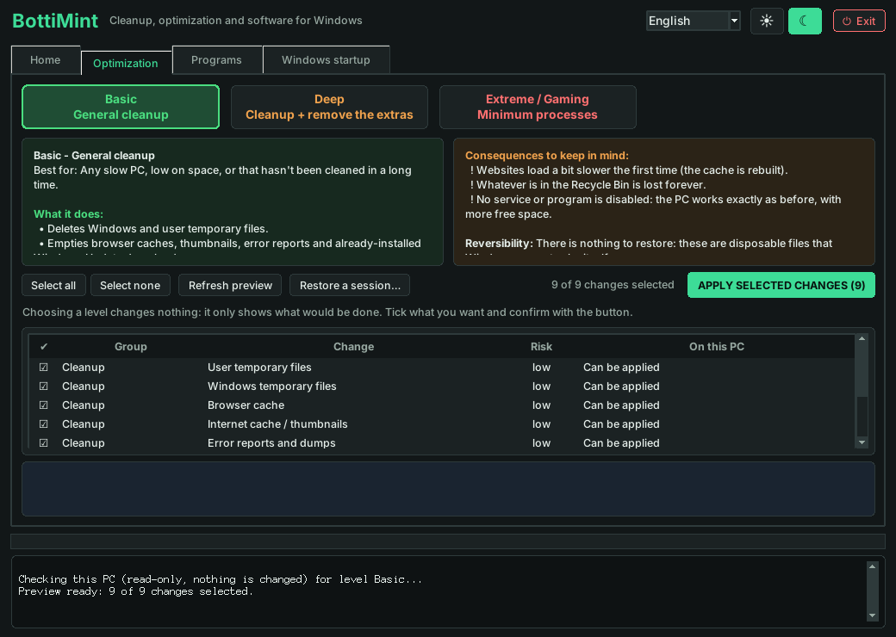

# BottiMint

🇺🇸 English · 🇦🇷 [Español](README.es.md)

A **Windows 10 / 11** tool for everyone: it cleans, optimizes by levels (everything **reversible**) and installs the software you need, all from a single interface.



> Screenshots are examples; the exact look depends on your Windows theme. The interface itself is available in Spanish, English, Russian, Japanese and Chinese.

## What it does

| Module | What it includes |
|---|---|
| **Tiered optimization** | **Basic** (general cleanup) · **Deep** (+ remove pre-installed apps and ads, scheduled telemetry, startup programs) · **Extreme / Gaming** (+ services, background processes, no animations, solid black desktop, power plan). Every change explains **what it does and what the consequence is**. |
| **Restore** | Before touching anything it creates a **Windows restore point** and checks that it exists (if that fails, **nothing is changed**). It also stores the original state of each setting and undoes it with one click. |
| **Programs** | Short, curated catalog (browsers, essentials, utilities, development, **gaming**: Steam, Epic, Ubisoft, EA, GOG, Battle.net…, runtimes) with **profiles** (office, gamer, tools). Installs silently with **winget** (and can install winget for you if it is missing). |
| **Windows startup** | Lists and enables/disables programs that start with the PC (reversible). |
| **Reports** | Generates a report of what was done, the consequences and how to go back, to keep or share. |

In a Windows 11 virtual machine (4 GB RAM, 2 vCPU) the three levels took Task Manager from **164 to 107 processes** and from **3.4 to 1.9 GB** of memory in use (before/after screenshots and caveats in the [VM test report](docs/VM_TEST_REPORT.md)).

Full details: [docs/NIVELES.md](docs/NIVELES.md) · [docs/PROGRAMAS.md](docs/PROGRAMAS.md).

## How to install

**Option A – the `.exe` (no Python required)**
1. Go to **[Releases](../../releases/latest)** and download `BottiMint.exe` and `BottiMint.exe.sha256`.
2. Verify its integrity (PowerShell):
   ```powershell
   (Get-FileHash .\BottiMint.exe -Algorithm SHA256).Hash.ToLower()   # must match the contents of the .sha256 file
   ```
3. Run it (it asks for administrator permissions).

**Option B – a script that downloads, verifies and runs**
```powershell
# PowerShell. Read the script before running it: scripts/descargar_y_ejecutar.ps1
irm https://raw.githubusercontent.com/shadoowww/bottimint-optimizer/main/scripts/descargar_y_ejecutar.ps1 -OutFile $env:TEMP\od.ps1
powershell -ExecutionPolicy Bypass -File $env:TEMP\od.ps1 -Repo shadoowww/bottimint-optimizer
```
It downloads the latest version, **checks the SHA256** and only then runs it. Add `-Tag v1.1.1` to pin a version.

**Option C – from source (requires Python 3.10+)**
```bash
git clone https://github.com/shadoowww/bottimint-optimizer.git
cd bottimint-optimizer
python -m bottimint          # graphical interface (run as administrator)
```
Or double-click `scripts/BottiMint.bat` (it requests administrator rights by itself).

> **SmartScreen / antivirus notice:** the `.exe` is not digitally signed and is packaged with PyInstaller, so Windows SmartScreen or some antivirus products may show a warning or a false positive. That is why the SHA256 is published and the code is open: you can audit it or build it yourself (`scripts/Compilar_exe.bat`).

## Usage

### Graphical interface
1. **Home:** review the machine's data (RAM, disk, SSD/HDD, battery, winget, permissions).
2. **Optimization:** pick a level → read what it does and its **consequences** (take your time) → review and adjust the list of changes (risky options come unchecked depending on the machine) → **Apply selected changes**. You must tick that you understood the consequences. Choosing a level only shows a preview; nothing is applied until you press the button.
3. **Restore a session…** undoes a previous optimization.
4. **Programs:** tick a profile (office / gamer / tools) or choose by hand → **Install selected**.

### Command line
The command-line keywords are in Spanish (like the code):
```text
python -m bottimint optimizar niveles                  # explains the 3 levels
python -m bottimint optimizar plan --nivel extremo     # preview on this machine (changes nothing)
python -m bottimint optimizar aplicar --nivel profundo [--sin id1,id2] [--solo id1,id2] [--si]
python -m bottimint optimizar sesiones                 # list sessions
python -m bottimint optimizar restaurar [--sesion YYYYMMDD_HHMMSS]
python -m bottimint programas perfiles                 # list profiles
python -m bottimint programas instalar --perfil gamer [--ids Valve.Steam] [--si]
python -m bottimint programas verificar                # checks that the IDs exist in winget
python -m bottimint programas actualizar               # update all programs
```
Levels: `basico`, `profundo`, `extremo`. Profiles: `oficina`, `gamer`, `herramientas`.

## Security and reversibility

- **Mandatory, verified restore point** before any change.
- **Per-session manifest** (`C:\ProgramData\BottiMint\sesiones\<date>\manifest.json`) with the previous state of each setting; it is saved after *every* change, so it survives a power cut.
- **Things it never touches:** Defender, Firewall, Windows Update (never disabled), network, audio, Microsoft Store, Calculator, Photos, Edge, personal files. There is no "registry cleaner".
- **Not reversible by the tool:** temporary files / recycle bin (disposable) and uninstalled apps (it tries to re-register them; otherwise reinstall from the Microsoft Store).
- It sends no data anywhere. The only network traffic is `winget` when installing programs (and, only if you press **Install winget**, the download of winget from Microsoft's official servers).

More in [docs/SEGURIDAD.md](docs/SEGURIDAD.md) and the full audit in [docs/AUDITORIA_SEGURIDAD.md](docs/AUDITORIA_SEGURIDAD.md). If you prefer to see it in action first, there is a [virtual machine testing guide](docs/PRUEBAS_VM.md).

## Project structure

Module and file names are in Spanish, like the code and the command line.
```text
bottimint/
  limpieza.py     # file cleanup (temp files, caches, recycle bin...) and system info
  nucleo.py       # levels engine: change catalog, restore point, apply/restore
  instalador.py   # program catalog, profiles and winget wrapper
  gui.py          # graphical interface (tkinter)
  widgets.py      # rounded widgets (buttons, level selectors, cards, dialogs)
  ajustes.py      # language and theme (nothing personal)
  i18n.py         # translations (es, en, ru, ja, zh)
  temas.py        # light/dark themes (☀ / ☾)
  __main__.py     # entry point (GUI or command line)
tests/            # tests against a simulated Windows (they never touch the real system)
scripts/          # .bat files, download-from-GitHub script, documentation generator
docs/             # documentation (NIVELES and PROGRAMAS are generated from the code)
.github/workflows # CI (tests) and release (builds the .exe and publishes the SHA256)
```
Detailed architecture: [docs/ARQUITECTURA.md](docs/ARQUITECTURA.md).

## Development

```bash
python -m unittest discover -s tests -t .        # tests (the GUI is tested if a display / xvfb is available)
python scripts/generar_docs.py                   # regenerates docs/NIVELES.md and docs/PROGRAMAS.md
scripts\Compilar_exe.bat                         # builds dist\BottiMint.exe (Windows)
```
No external dependencies to run (standard library only).

## Roadmap

- [x] Windows 11 VM test with before/after measurements ([report](docs/VM_TEST_REPORT.md)).
- [ ] Real screenshots of the app on Windows and tests on Windows 10.
- [ ] More install profiles on request.
- [ ] Digital signature for the `.exe`.
- [ ] Basic security scan (Defender, firewall, ports and suspicious processes).

## Disclaimer

The software is provided "as is", without warranty (see [LICENSE](LICENSE)). Apply the Deep and Extreme levels only with the owner's consent and after explaining the consequences. Program and brand names belong to their respective owners; this project is not affiliated with them.

## License

[MIT](LICENSE)
