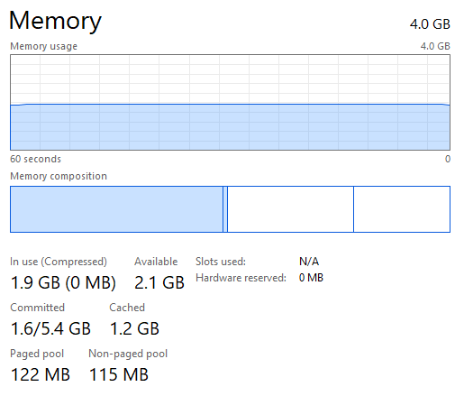
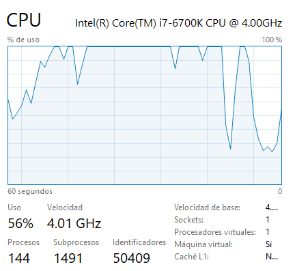
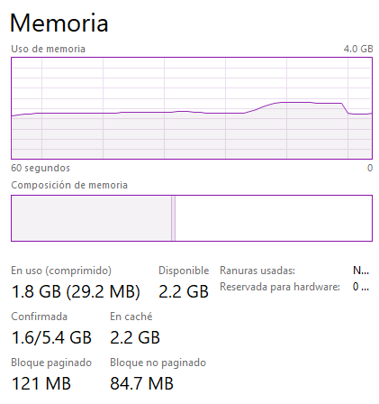
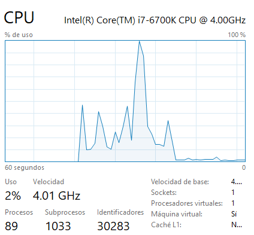
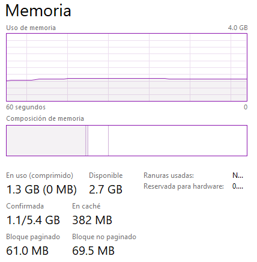

# VM test report: Windows 11 and Windows 10

Measurements taken with Windows Task Manager in virtual machines, before and after applying the three optimization levels (Basic → Deep → Extreme / Gaming) in a single session. Each level was run with a verified Windows restore point created first.

## Summary

| Metric | Win 11 before | Win 11 after | Win 10 before | Win 10 after |
|---|---|---|---|---|
| Processes | 164 | **107** | 144 | **89** |
| Threads | 1,991 | 1,256 | 1,491 | 1,033 |
| Handles | 66,171 | 41,945 | 50,409 | 30,283 |
| Memory in use | 3.4 GB | **1.9 GB** | 1.8 GB | **1.3 GB** |
| Memory available | 547 MB | 2.1 GB | 2.2 GB | 2.7 GB |
| Committed | 3.2 / 5.4 GB | 1.6 / 5.4 GB | 1.6 / 5.4 GB | 1.1 / 5.4 GB |
| Cached | 555 MB | 1.2 GB | 2.2 GB | 382 MB |
| CPU at capture | 43 % | idle | 56 % | 2 % |

| | Processes | Memory in use |
|---|---|---|
| Windows 11 | −57 (−35 %) | −1.5 GB (−44 %) |
| Windows 10 | −55 (−38 %) | −0.5 GB (−28 %) |

## Environment

| Item | Windows 11 | Windows 10 |
|---|---|---|
| Date | 2026-11-24 | 2026-11-25 |
| Guest | VM, 4 GB RAM, 2 vCPU | VM, 4 GB RAM (Task Manager shows 1 virtual processor) |
| Host CPU | Intel Core i7-6700K @ 4.00 GHz | same |
| Account | Administrator | Administrator |
| BottiMint | levels run in one session | v1.2.0, levels run in one session |

---

## Windows 11

### Before

| CPU / processes | Memory |
|---|---|
|  |  |

### After

| CPU / processes | Memory |
|---|---|
|  |  |

### What each level did

| Level | Restore point | Result |
|---|---|---|
| Basic – general cleanup | ✅ created and verified | 9 of 9 changes OK. About 1.15 GB of temporary files, caches and recycle bin removed (largest: Delivery Optimization cache 573 MB, user temporary files 266 MB, Windows Update cache 255 MB). |
| Deep – cleanup + remove extras | ✅ created and verified | 14 of 14 changes OK. 8 pre-installed apps and Phone Link / Mail removed, 16 advertising and suggestion settings turned off, 6 telemetry tasks disabled, 1 startup program disabled, WinSxS component cleanup completed. |
| Extreme / Gaming | ✅ created and verified | 25 of 25 changes OK. Telemetry at minimum, services adjusted (telemetry, rarely used, location, Delivery Optimization, SysMain, Windows Search, Print Spooler, Bluetooth, Xbox), background Store apps blocked, Game Mode on, minimal visual effects, High performance power plan. |

Every level took roughly 35–50 seconds, including creating and verifying the restore point.

---

## Windows 10

### Before

| CPU / processes | Memory |
|---|---|
|  |  |

### After

| CPU / processes | Memory |
|---|---|
|  |  |

### What each level did

| Level | Restore point | Result |
|---|---|---|
| Basic – general cleanup | ✅ created and verified | 9 of 9 changes OK. About 124 MB freed (browser cache 66 MB, user temporary files 40 MB, Windows Update cache 12 MB, thumbnails 6 MB). Took about 70 s. |
| Deep – cleanup + remove extras | ✅ created and verified | 14 of 14 changes OK. 12 pre-installed apps and Phone Link / Mail removed, 16 advertising and suggestion settings turned off, 8 telemetry tasks disabled, WinSxS component cleanup completed. Took about 45 s. |
| Extreme / Gaming | ✅ created and verified | 26 of 26 changes OK. Same set as on Windows 11, plus the v1.2.0 items: all Windows animations off (ClearType kept) and solid black desktop. Took about 47 s. |

Reported free disk space went 29.5 → 29.1 GB (Basic), 29.0 → 28.6 GB (Deep) and 27.3 → 27.5 GB (Extreme). It did not grow in the first two levels because each restore point takes space on its own; the cleanups were small on a fresh VM.

---

## How to read these numbers (honest notes)

- **The "before" captures are not idle.** Both were taken on a freshly installed VM with Windows still settling (CPU at 43 % on Windows 11 and 56 % on Windows 10). An idle "before" would be lower, so the real improvement on a settled machine is smaller than the tables suggest. In an earlier idle run on Windows 11 we measured about **140 → 100 processes** and **2.4 → 2.0 GB**, which is a fairer estimate there. Even so, the VMs felt noticeably faster after the tweaks.
- "Memory in use" includes compressed memory. Everything was measured in VMs with only 4 GB of RAM; on real hardware the numbers will differ.
- One run per system and level; this is evidence of the effect, not a statistical benchmark.
- The "after" captures were taken after all three levels, including Extreme, which disables services (print spooler, Bluetooth, Xbox, search indexing…). Those have functional consequences explained in the app and in [NIVELES.md](NIVELES.md).
- The Windows 10 run used v1.2.0, so the animations and black desktop changes were reported as applied (OK). Their visual result has not been checked by eye yet.

## Not tested yet

- Restoring each session and comparing against a snapshot.
- Running the program installer profiles in the VMs, and the *Install winget* button on a system without winget.
- Visual check of the v1.2.0 changes (black desktop, no animations, sharp text) and that a restore brings the wallpaper and effects back.
- Real hardware.

See [PRUEBAS_VM.md](PRUEBAS_VM.md) for the full checklist.
