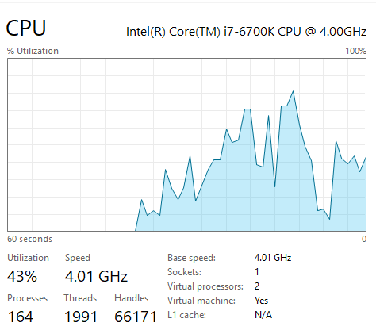
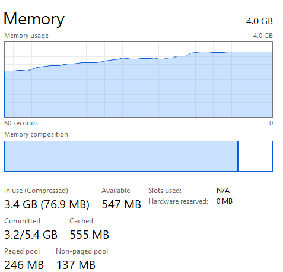
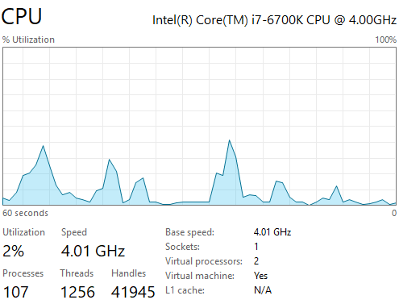

# Windows 11 VM test report

Measurements taken with Windows Task Manager in a virtual machine, before and after applying the three optimization levels (Basic → Deep → Extreme / Gaming) in a single session.

## Environment

| Item | Value |
|---|---|
| Date | 2026-11-24 |
| Guest | Windows 11 virtual machine, **4 GB RAM, 2 virtual processors** |
| Host CPU | Intel Core i7-6700K @ 4.00 GHz (VirtualBox) |
| Account | Administrator |
| BottiMint | levels run in one session (Basic, then Deep, then Extreme); a restore point was created and verified before each level |

## Result

| Metric | Before | After | Change |
|---|---|---|---|
| Processes | **164** | **107** | −57 (−35 %) |
| Threads | 1,991 | 1,256 | −735 (−37 %) |
| Handles | 66,171 | 41,945 | −24,226 (−37 %) |
| Memory in use | **3.4 GB** | **1.9 GB** | −1.5 GB (−44 %) |
| Memory available | 547 MB | 2.1 GB | +1.6 GB |
| Committed memory | 3.2 / 5.4 GB | 1.6 / 5.4 GB | −1.6 GB |
| Cached | 555 MB | 1.2 GB | |

### Before

| CPU / processes | Memory |
|---|---|
|  |  |

### After

| CPU / processes | Memory |
|---|---|
|  |  |

## How to read these numbers (honest notes)

- The **"before" capture was taken right after a fresh install**, while Windows was still settling: CPU at 43 % and memory still climbing in the graph. An idle "before" would be lower, so the real improvement on a settled machine is smaller than the table suggests. In an earlier run on the same kind of VM, with the system idle, we measured about **140 → 100 processes** and **2.4 → 2.0 GB** of RAM, which is a fairer estimate of the difference.
- "Memory in use" includes compressed memory. Everything was measured in a VM with only 4 GB of RAM; on real hardware the numbers will differ.
- A single run per level; this is evidence of the effect, not a statistical benchmark.
- The "after" capture was taken after all three levels, including Extreme, which disables services (print spooler, Bluetooth, Xbox, search indexing…). Those have functional consequences that are explained in the app and in [NIVELES.md](NIVELES.md).

## What each level did (from the generated reports)

| Level | Restore point | Result |
|---|---|---|
| Basic – general cleanup | ✅ created and verified | 9 of 9 changes OK. About 1.15 GB of temporary files, caches and recycle bin removed (largest: Delivery Optimization cache 573 MB, user temporary files 266 MB, Windows Update cache 255 MB). |
| Deep – cleanup + remove extras | ✅ created and verified | 14 of 14 changes OK. 8 pre-installed apps and Phone Link / Mail removed, 16 advertising and suggestion settings turned off, 6 telemetry tasks disabled, 1 startup program disabled, WinSxS component cleanup completed. |
| Extreme / Gaming | ✅ created and verified | 25 of 25 changes OK. Telemetry at minimum, services adjusted (telemetry, rarely used, location, Delivery Optimization, SysMain, Windows Search, Print Spooler, Bluetooth, Xbox), background Store apps blocked, Game Mode on, minimal visual effects, High performance power plan. |

Every level took roughly 35–50 seconds, including creating and verifying the restore point.

## Not tested yet

- Windows 10.
- Restoring each session and comparing against a snapshot.
- Running the programs installer profiles in the VM.
- Version 1.2.0 specifics: animations off with ClearType kept, solid black desktop, and the *Install winget* button.

See [PRUEBAS_VM.md](PRUEBAS_VM.md) for the full checklist.
